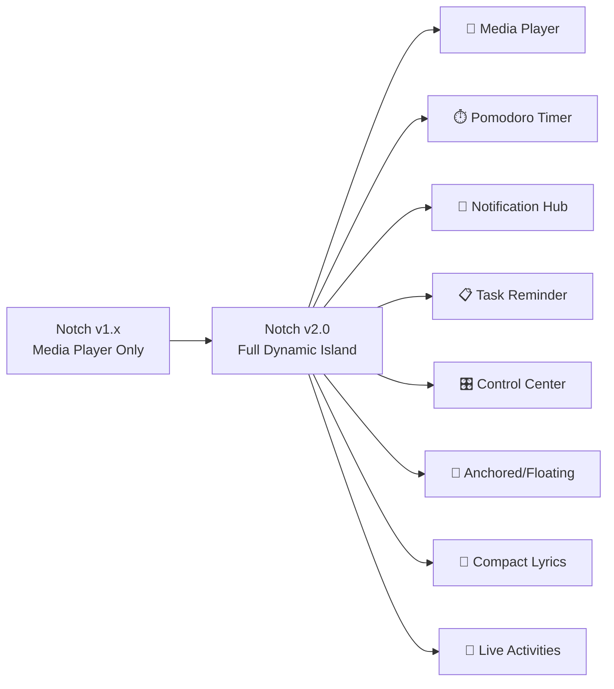
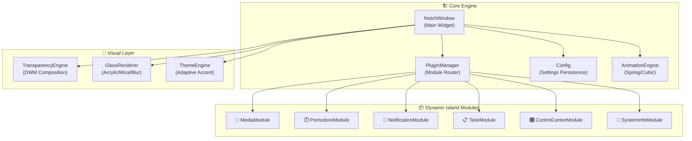
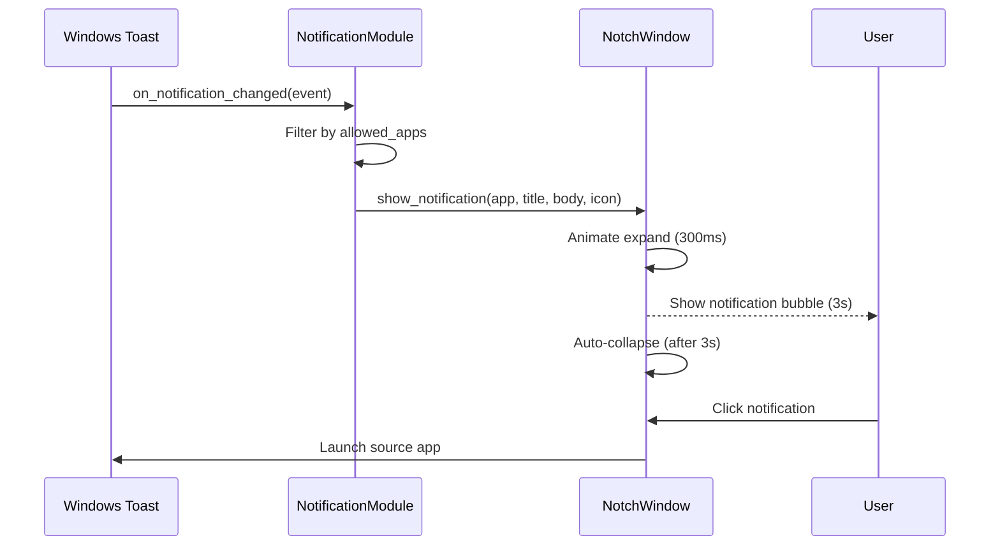

# 📋 PRD — Notch v2.0 "Dynamic Island for Windows"

> **Product Requirements Document** · Versi 2.0
> Tanggal: 15 November 2026
> Referensi: [Grump](https://yeazka.github.io/Grump/) · iOS Dynamic Island · [Pillar](https://github.com/warpirate/pillar-dynamic-island-for-windows) · [ReactBits](https://reactbits.dev/)

---

## 1. Executive Summary

**Notch v2.0** adalah evolusi besar dari Notch v1.x — dari sekadar media player overlay menjadi **Dynamic Island penuh fitur untuk Windows** yang setara dengan iOS Dynamic Island dan kompetitor seperti Grump, Pillar, dan Bloom.

### Masalah Utama di v1.x yang Harus Diperbaiki:

| # | Masalah | Status |
|---|---------|--------|
| 1 | **Background tidak transparan** — terlihat kotak hitam solid di belakang notch | 🔴 Critical |
| 2 | Hanya mendukung fitur **media player** saja | 🟡 Missing |
| 3 | Tidak ada mode **Anchored vs Floating** | 🟡 Missing |
| 4 | Tidak ada **Pomodoro Timer** | 🟡 Missing |
| 5 | Tidak ada **Notification Listener** (WhatsApp, dll.) | 🟡 Missing |
| 6 | Tidak ada **Task Reminder / To-Do** | 🟡 Missing |
| 7 | Tidak ada **Control Center** (volume, brightness, dll.) | 🟡 Missing |

> [!IMPORTANT]
> Prioritas #1 absolut: memperbaiki transparansi latar belakang agar notch benar-benar transparan tembus ke desktop, bukan kotak hitam.

---

## 2. Goals & Vision



### Vision Statement
> Menjadi **satu-satunya overlay desktop yang kamu butuhkan** — cantik, ringan, dan berguna di setiap saat — baik saat mendengarkan musik, fokus kerja, maupun menerima pesan.

---

## 3. Arsitektur & Module Map



---

## 4. Fitur Detail per Module

### 4.1 🔧 Transparansi & Visual Engine (CRITICAL FIX)

> [!CAUTION]
> Bug paling mencolok di v1.x: background notch **tidak transparan**. Terlihat sebagai kotak hitam solid alih-alih tembus pandang ke desktop di belakangnya.

**Root Cause Analysis:**
- `WA_TranslucentBackground` mungkin tidak diterapkan sebelum `show()`
- DWM Acrylic Blur tidak meng-clip ke bentuk rounded pill
- Region mask / `setMask()` tidak sinkron dengan painted shape

**Solusi yang Harus Diimplementasikan:**

| Teknik | Deskripsi | Prioritas |
|--------|-----------|-----------|
| `WA_TranslucentBackground` | Set di constructor SEBELUM `show()` | P0 |
| `WA_NoSystemShadow` | Hilangkan shadow Windows bawaan | P0 |
| `FramelessWindowHint` + `Tool` | Window tanpa frame dan tanpa taskbar entry | P0 |
| `setMask(QRegion)` | Clip region tepat ke bentuk pill/squircle yang di-paint | P0 |
| DWM `DWMWA_SYSTEMBACKDROP_TYPE` | Gunakan Mica Alt (value=4) bukan Acrylic (value=3) untuk blur yang lebih halus | P1 |
| QPainter `CompositionMode_Source` | Clear area di luar bentuk pill ke `Qt::transparent` | P0 |
| Per-pixel alpha compositing | Gunakan `UpdateLayeredWindow` + 32-bit ARGB bitmap untuk transparansi sempurna per-pixel | P1 |

**Pilihan Layout Mode — Anchored vs Floating:**

| Mode | Deskripsi | Visual |
|------|-----------|--------|
| **Anchored** | Notch menempel di tepi atas layar, y=0, bentuk organik concave keluar dari bezel seperti hardware notch fisik iPhone/MacBook. Background transparan penuh, hanya bentuk pill yang terlihat. | Seperti referensi Image 2 (collapsed notch shape) |
| **Floating** | Notch melayang dengan jarak dari tepi atas (configurable 8-40px). Memiliki subtle drop shadow dan glassmorphism. Bisa di-drag ke posisi manapun di layar. | Seperti referensi Grump floating mode |

```
┌─────────────────────── Monitor ───────────────────────┐
│                                                        │
│    ┌────────────────────┐  ← Anchored (y=0, flush)    │
│    │   ╭──────────────╮ │                              │
│    │   │  🎵 Now Playing │                              │
│    │   ╰──────────────╯ │                              │
│    └────────────────────┘                              │
│                                                        │
│         ╭──────────────╮   ← Floating (y=12, shadow)  │
│         │  🎵 Now Playing │                              │
│         ╰──────────────╯                               │
│                                                        │
└────────────────────────────────────────────────────────┘
```

---

### 4.2 🎵 Media Module (Enhanced dari v1.x)

**Status:** Sudah ada di v1.x, perlu enhancement.

#### States & Layouts:

| State | Tampilan | Trigger |
|-------|----------|---------|
| **Idle** | Pill kecil tanpa info musik (dot center biru) | Tidak ada media aktif |
| **Collapsed Minimal** | Album art mini + 4-bar animated equalizer | Musik sedang diputar, mouse jauh |
| **Collapsed Compact** | Album art + Judul + Equalizer | Musik sedang diputar |
| **Collapsed Lyrics** | Album art + Single-line lyric scrolling + Equalizer | User pilih mode lyrics |
| **Expanded Player** | Full player: art, title/artist, slider, controls, source badge, dots | Mouse hover / click |
| **Expanded Lyrics** | 3-line synced lyrics view (prev, active glow, next) | Click mic icon / swipe dots |

#### Fitur Baru Media:
- [ ] Seek slider yang bisa di-klik dan di-drag (sudah partial di v1.x)
- [ ] Smooth crossfade album art saat ganti lagu
- [ ] Waveform visualizer mode (opsional ganti equalizer bar)
- [ ] Source detection badges: Spotify (hijau), YouTube Music (merah), Browser (biru), dll.

---

### 4.3 ⏱️ Pomodoro Timer Module (NEW)

**Inspirasi:** iOS Timer di Dynamic Island, Grump Focus Timer, Pillar Pomodoro

#### Fitur:

| Komponen | Deskripsi |
|----------|-----------|
| **Preset Durations** | 25/5 (Pomodoro klasik), 50/10 (deep work), 90/20 (ultradian), custom |
| **Visual Timer** | Progress ring / arc yang mengecil di collapsed state |
| **Collapsed State** | Pill menampilkan ikon timer + countdown teks `12:34` |
| **Expanded State** | Ring besar, tombol Play/Pause/Reset, label sesi (Focus/Break) |
| **Phase Auto-Switch** | Otomatis switch Focus → Break → Focus dengan notifikasi suara |
| **Session Counter** | Tampilkan `Session 3/4` atau dot indicators |
| **Desktop Notification** | Toast notification saat timer selesai + suara chime |
| **Multi-Activity** | Bisa berjalan bersamaan dengan media player (split pill) |

#### Collapsed Pomodoro Visual:
```
╭───────────────────────────────╮
│  🍅  Focus  ██████░░  12:34  │
╰───────────────────────────────╯
```

#### Expanded Pomodoro Visual:
```
╭──────────────────────────────────────╮
│                                      │
│          ╭─────────────╮             │
│         ╱   12 : 34     ╲            │
│        │    ◉ Focus      │           │
│         ╲  Session 2/4  ╱            │
│          ╰─────────────╯             │
│                                      │
│      [⏸ Pause]  [⏹ Stop]  [⏭ Skip]  │
│                                      │
╰──────────────────────────────────────╯
```

---

### 4.4 💬 Notification Hub Module (NEW)

**Inspirasi:** iOS Dynamic Island notification alerts, Grump notification forwarding

#### Fitur:

| Komponen | Deskripsi |
|----------|-----------|
| **Windows Notification Listener** | Intercept toast notifications via WinRT `UserNotificationListener` API |
| **App Filtering** | User bisa pilih aplikasi mana yang ditampilkan (WhatsApp, Telegram, Discord, Gmail, dll.) |
| **Live Alert Animation** | Notch "expands briefly" saat notifikasi masuk, menampilkan ikon app + pesan singkat, lalu collapse kembali |
| **Notification Queue** | Jika multiple notifications masuk berurutan, tampilkan antrian dengan auto-dismiss |
| **WhatsApp Integration** | Tampilkan sender name, pesan preview (truncated), dan ikon profil jika tersedia |
| **Click-to-Open** | Klik pada notification bubble → buka aplikasi pengirim |
| **Do Not Disturb** | Mode DND yang suppress semua notifikasi kecuali timer |
| **Notification History** | Expanded view menampilkan 5 notifikasi terakhir dalam scrollable list |

#### Flow Notifikasi Masuk:



#### Collapsed Notification Visual:
```
╭──────────────────────────────────────────╮
│  📱 WhatsApp  Budi: "Udah sampe belum?"  │
╰──────────────────────────────────────────╯
```

#### Expanded Notification History:
```
╭──────────────────────────────────────────╮
│  📱 Notifications (3 new)                │
│                                          │
│  💬 WhatsApp · Budi · 2m ago             │
│     "Udah sampe belum?"                  │
│                                          │
│  📧 Gmail · John · 5m ago               │
│     "Meeting at 3pm today"               │
│                                          │
│  🔔 Discord · #general · 8m ago         │
│     "Anyone up for valorant?"            │
│                                          │
│              [Clear All]                 │
╰──────────────────────────────────────────╯
```

---

### 4.5 📋 Task Reminder / Quick Notes Module (NEW)

**Inspirasi:** Grump Quick Notes, iOS Reminders widget

#### Fitur:

| Komponen | Deskripsi |
|----------|-----------|
| **Quick Add** | Ketik task baru langsung dari expanded view |
| **Task List** | Tampilkan 3-5 tasks dalam expanded view dengan checkbox |
| **Due Time** | Opsional set waktu reminder |
| **Collapsed Preview** | Tampilkan jumlah tasks tersisa: `📋 3 tasks` |
| **Reminder Alerts** | Auto-expand notch saat task due time tercapai |
| **Persistence** | Simpan ke SQLite lokal di `%APPDATA%/Notch/tasks.db` |
| **Completion Animation** | Strikethrough + fade out saat task di-check |

#### Collapsed Task Visual:
```
╭───────────────────────────╮
│  📋 3 tasks remaining     │
╰───────────────────────────╯
```

#### Expanded Task Visual:
```
╭──────────────────────────────────────────╮
│  📋 Today's Tasks                        │
│                                          │
│  ☐ Review PR #142              due 14:00 │
│  ☐ Call dentist                due 16:30 │
│  ☑ Push hotfix v1.0.1         ✓ done     │
│                                          │
│  [+ Add Task]          [🗑 Clear Done]   │
╰──────────────────────────────────────────╯
```

---

### 4.6 🎛️ Control Center Module (NEW)

**Inspirasi:** Grump Control Center, iOS Control Center

#### Fitur:

| Komponen | Deskripsi |
|----------|-----------|
| **Volume Slider** | System master volume dengan drag slider |
| **Brightness Slider** | Monitor brightness control (WMI/DDC-CI) |
| **Wi-Fi Toggle** | On/Off indicator (read-only status) |
| **Bluetooth Toggle** | On/Off indicator (read-only status) |
| **Battery Status** | Persentase + charging indicator (untuk laptop) |
| **DND Toggle** | Enable/disable Do Not Disturb mode |
| **Keyboard Shortcut** | Buka Control Center dengan `Win+Shift+N` |

#### Expanded Control Center Visual:
```
╭──────────────────────────────────────────╮
│  🎛️ Control Center                      │
│                                          │
│  🔊 Volume   ████████░░░░  72%          │
│  ☀️ Bright   ██████░░░░░░  55%          │
│                                          │
│  📶 Wi-Fi: Connected    🔵 BT: On       │
│  🔋 Battery: 84%        🌙 DND: Off     │
╰──────────────────────────────────────────╯
```

---

### 4.7 🔋 System Info Module (NEW)

**Inspirasi:** iOS battery indicator, Grump system widgets

#### Fitur:

| Komponen | Deskripsi |
|----------|-----------|
| **Battery Level** | Persentase + icon animasi charging |
| **CPU/RAM** | Opsional: mini usage bar |
| **Clock** | Jam digital mini di collapsed state |
| **Weather** | Suhu + ikon cuaca (via free API, opsional) |

---

### 4.8 💧 Hydration Reminder Module (NEW — dari Grump)

**Inspirasi:** Grump Hydration Notice

#### Fitur:

| Komponen | Deskripsi |
|----------|-----------|
| **Target Harian** | User set target minum (default 2.0 L) |
| **Reminder Interval** | Notifikasi setiap N menit (30/45/60/90) |
| **Quick Action** | Tombol inline "Udah Minum 💧" dan "Nanti" langsung di pill |
| **Progress Tracker** | Tampilkan `0.5 / 2.0 L` di collapsed state |
| **Persistence** | Simpan log harian di SQLite, reset tiap hari |

#### Collapsed Visual:
```
╭──────────────────────────────────────────────╮
│  💧 BELUM MINUM!  ░░░░░░░░  0.0 / 2.0 L     │
╰──────────────────────────────────────────────╯
```

---

### 4.9 🔒 Privacy Indicator Dots (NEW — dari Grump & iOS)

**Inspirasi:** iOS/macOS privacy dots, Grump Privacy Indicator

#### Fitur:

| Komponen | Deskripsi |
|----------|-----------|
| **Microphone Dot** | 🟠 Titik oranye muncul saat mic sedang diakses aplikasi |
| **Camera Dot** | 🟢 Titik hijau muncul saat webcam aktif |
| **Screen Recording** | 🔴 Titik merah saat screen recording berlangsung |
| **Posisi** | Dot muncul di kanan atas notch pill, selalu visible di atas semua modul |

Implementasi menggunakan WinRT `AppCapability` API atau periodic polling via `tasklist` / device query.

---

### 4.10 🤖 AI Activity Indicator (NEW — fitur unik Grump)

**Inspirasi:** Grump AI Activity status pills

#### Fitur:

| Komponen | Deskripsi |
|----------|-----------|
| **Process Detection** | Deteksi terminal process aktif: `claude`, `gemini`, `cursor`, `copilot`, `agy` |
| **Status Pill** | Mini pill indicator menampilkan nama tool + status (Running / Idle / Error) |
| **Collapsed Visual** | Ikon kecil + nama tool di sebelah kanan pill utama |

Ini fitur opsional yang sangat relevan untuk developer audience.

---

### 4.11 🎨 Tema Visual: Obsidian vs Liquid Glass (dari Grump)

**Inspirasi:** Grump dual aesthetic themes

| Tema | Deskripsi |
|------|-----------|
| **Obsidian** | Pure pitch black solid, zero blur, high contrast — performa ringan untuk PC low-spec |
| **Liquid Glass** | Frosted backdrop blur (DWM Acrylic/Mica), refleksi cahaya, ambient glow dari album art |
| **Custom** | User bisa atur opacity, blur intensity, accent color secara granular |

User bisa switch tema dari Settings atau right-click context menu.

---

## 5. Multi-Activity / Split Pill

**Inspirasi:** iOS Dynamic Island split mode — saat 2 aktivitas berjalan bersamaan.

Ketika **media player** + **pomodoro timer** aktif bersamaan:

```
╭────────────╮ ╭──────────╮
│ 🎵 ▶ ||||  │ │ 🍅 12:34 │
╰────────────╯ ╰──────────╯
```

Satu pill utama (media) dan satu pill satelit kecil (timer) — keduanya bisa di-tap untuk expand masing-masing.

#### Rules:
1. Maksimal 2 aktivitas visible bersamaan di collapsed state
2. Aktivitas terbaru mendapat pill utama (kiri), aktivitas sekunder mendapat pill kecil (kanan)
3. Saat expanded, hanya 1 modul yang tampil full — modul lain menjadi mini indicator di pojok

---

## 6. Interaksi & Gesture

| Gesture | Aksi |
|---------|------|
| **Hover** | Auto-expand modul aktif |
| **Click** | Open/activate target (play, check task, open notification) |
| **Double Click** | Toggle expand/collapse manual |
| **Right Click** | Context menu: Switch module, Settings, Quit |
| **Drag** | Pindahkan posisi notch (mode Floating only) |
| **Scroll Wheel** | Scroll melalui notification history / task list di expanded view |
| **Keyboard `Win+Shift+N`** | Toggle notch visibility |
| **Keyboard `Win+Shift+P`** | Start/pause Pomodoro |
| **Long Press (500ms)** | Expand ke full-size control center |

---

## 7. Settings (Enhanced)

Settings dialog harus di-upgrade menjadi tabbed/sectioned:

### Tab 1: Appearance
- Glass Opacity (slider 0-100%)
- Corner Curvature (slider 16-32px)
- Dynamic Accent from Album Art (toggle)
- Custom Accent Color (color picker)
- **Layout Mode: Anchored / Floating** (radio/combo)
- Floating offset from top (slider, hanya jika Floating)
- **Background Effect: Acrylic / Mica / Solid Dark / None** (combo)

### Tab 2: Media
- Show Album Art (toggle)
- Show Progress Bar (toggle)
- Show Lyrics (toggle)
- Lyrics Font Size (slider)
- Sync Offset (slider -500 to +500 ms)
- Collapsed Mode: minimal / compact / lyrics (combo)
- Auto-expand on new song (toggle)
- Collapse delay (slider 2-15s)

### Tab 3: Modules
- Enable/Disable each module (toggles):
  - 🎵 Media Player
  - ⏱️ Pomodoro Timer
  - 💬 Notifications
  - 📋 Task Reminder
  - 🎛️ Control Center
  - 🔋 System Info

### Tab 4: Notifications
- Allowed Apps list (multi-select checkboxes)
- Alert duration (slider 2-8s)
- Alert sound (toggle + sound picker)
- Do Not Disturb schedule (time picker)

### Tab 5: Pomodoro
- Focus duration (spinner, default 25 min)
- Break duration (spinner, default 5 min)
- Long break duration (spinner, default 15 min)
- Sessions before long break (spinner, default 4)
- Auto-start break after focus (toggle)
- Completion sound (toggle + picker)

### Tab 6: General
- Start with Windows (toggle + registry)
- Horizontal alignment: Left / Center / Right (combo)
- Horizontal offset (slider)
- Global hotkeys configuration
- Check for updates (button)
- About & Version info

---

## 8. Tech Stack & Implementasi

| Layer | Teknologi | Catatan |
|-------|-----------|---------|
| **GUI Framework** | PyQt6 + PyQt-Fluent-Widgets | Sudah digunakan di v1.x |
| **Window Transparency** | `WA_TranslucentBackground` + `setMask(QRegion)` + `FramelessWindowHint` | FIX critical dari v1.x |
| **Blur Effect** | `qframelesswindow.WindowEffect` (Acrylic/Mica) | Sudah digunakan |
| **Animation** | `QPropertyAnimation` + `QEasingCurve.OutCubic` / custom spring | Sudah digunakan |
| **Media Detection** | WinRT `winsdk.windows.media.control` (SMTC) | Sudah digunakan |
| **Lyrics** | LRCLIB API + SQLite cache | Sudah digunakan |
| **Notification Listener** | WinRT `UserNotificationListener` API | **Baru** |
| **System Controls** | `pycaw` (volume), WMI (brightness), `psutil` (system info) | **Baru** |
| **Task Storage** | SQLite (`%APPDATA%/Notch/tasks.db`) | **Baru** |
| **Hotkeys** | `keyboard` lib atau `pynput` (global hotkey registration) | **Baru** |
| **Compiler** | Nuitka standalone | Sudah ada script |
| **Packaging** | Single `.exe` via Nuitka | Sudah ada |

### Dependency Baru:
```
pip install pycaw         # Volume control
pip install psutil        # System info (CPU, RAM, Battery)
pip install pynput        # Global hotkeys
```

> [!NOTE]
> `winrt-windows.ui.notifications` dan `winrt-windows.ui.notifications.management` biasanya sudah ter-bundle dalam `winsdk` yang sudah diinstall.

---

## 9. Struktur File v2.0

```
d:\projects\notch\
├── notch_py/
│   ├── main.py                    # Entry point
│   ├── notch_window.py            # Main Dynamic Island window
│   ├── plugin_manager.py          # Module router & lifecycle   [NEW]
│   ├── animation_engine.py        # Spring / cubic helpers      [NEW]
│   ├── transparency.py            # DWM transparency fix        [NEW]
│   │
│   ├── modules/                                                 [NEW]
│   │   ├── __init__.py
│   │   ├── base_module.py         # Abstract base for all modules
│   │   ├── media_module.py        # 🎵 Music player (refactored from notch_window)
│   │   ├── pomodoro_module.py     # ⏱️ Pomodoro timer
│   │   ├── notification_module.py # 💬 Notification hub
│   │   ├── task_module.py         # 📋 Task reminder
│   │   ├── control_center.py      # 🎛️ Control center
│   │   └── system_info.py         # 🔋 System info
│   │
│   ├── media_service.py           # WinRT SMTC (existing)
│   ├── lyrics_engine.py           # LRCLIB API (existing)
│   ├── notification_service.py    # WinRT UserNotificationListener  [NEW]
│   ├── system_service.py          # Volume/Brightness/Battery       [NEW]
│   ├── task_service.py            # SQLite task CRUD                [NEW]
│   ├── hotkey_service.py          # Global hotkey registration      [NEW]
│   │
│   ├── color_thief.py             # Accent extraction (existing)
│   ├── config.py                  # Settings persistence (enhanced)
│   ├── settings_dialog.py         # Tabbed settings UI (enhanced)
│   ├── tray_manager.py            # System tray (enhanced)
│   │
│   ├── build_nuitka.py            # Nuitka compiler (existing)
│   └── build_nuitka.bat           # One-click build (existing)
│
├── dist/                          # .NET version (legacy)
├── dist_py/                       # Nuitka build output
├── README.md
└── CHANGELOG.md                   # [NEW]
```

---

## 10. Module Base Class (API Contract)

Setiap modul harus mengimplementasikan interface berikut:

```python
class BaseModule(ABC):
    """Abstract base class for all Dynamic Island modules."""
    
    @property
    @abstractmethod
    def module_id(self) -> str:
        """Unique identifier: 'media', 'pomodoro', 'notifications', etc."""
    
    @property
    @abstractmethod
    def display_name(self) -> str:
        """Human-readable name for settings UI."""
    
    @abstractmethod
    def paint_collapsed(self, painter: QPainter, rect: QRectF, is_primary: bool):
        """Draw collapsed state content within given rect."""
    
    @abstractmethod
    def paint_expanded(self, painter: QPainter, rect: QRectF):
        """Draw expanded state content within given rect."""
    
    @abstractmethod
    def hit_test(self, pos: QPointF, is_expanded: bool) -> Optional[str]:
        """Return action target name if pos hits an interactive element."""
    
    @abstractmethod
    def on_click(self, target: str):
        """Handle click on a target returned by hit_test."""
    
    @abstractmethod
    def get_collapsed_width(self) -> int:
        """Preferred width when in collapsed pill state."""
    
    @abstractmethod
    def has_activity(self) -> bool:
        """Whether this module has active content to show (e.g. music playing, timer running)."""
    
    def on_tick(self, dt_ms: int):
        """Called every 250ms for time-based updates."""
        pass
    
    def on_module_activated(self):
        """Called when this module becomes the primary visible module."""
        pass
    
    def on_module_deactivated(self):
        """Called when another module takes over the display."""
        pass
```

---

## 11. Prioritas & Roadmap

### Phase 1 — Foundation (v2.0-alpha) · 1-2 minggu
- [x] Fix force close pada media controls (DONE di v1.0.1)
- [ ] **Fix transparansi background** (P0 Critical)
- [ ] Implementasi layout mode **Anchored vs Floating**
- [ ] Refactor `notch_window.py` → modular architecture (`BaseModule` + `PluginManager`)
- [ ] Migrasi media player code ke `MediaModule`

### Phase 2 — Pomodoro & Tasks (v2.0-beta) · 1 minggu
- [ ] `PomodoroModule` — full timer lifecycle
- [ ] `TaskModule` — SQLite-backed task CRUD
- [ ] Split pill rendering (2 aktivitas bersamaan)
- [ ] Enhanced settings dialog (tabbed)

### Phase 3 — Notifications (v2.1) · 1 minggu
- [ ] `NotificationModule` — WinRT listener + filtering
- [ ] WhatsApp/Telegram/Discord notification forwarding
- [ ] Alert animations + notification queue
- [ ] Do Not Disturb mode

### Phase 4 — Control Center & Polish (v2.2) · 1 minggu
- [ ] `ControlCenterModule` — volume, brightness, toggles
- [ ] `SystemInfoModule` — battery, CPU/RAM
- [ ] Global hotkeys (`Win+Shift+N`, `Win+Shift+P`)
- [ ] Nuitka re-build + new GitHub release

---

## 12. KPI / Success Metrics

| Metric | Target |
|--------|--------|
| Startup to visible | < 1.5s |
| RAM usage idle | < 60 MB |
| CPU usage idle | < 1% |
| Animation FPS | ≥ 60fps |
| Force crash rate | 0% |
| Module switch latency | < 100ms |
| Notification display latency | < 500ms from Windows toast |

---

## 13. Risiko & Mitigasi

| Risiko | Impact | Mitigasi |
|--------|--------|----------|
| `UserNotificationListener` butuh permission khusus di Windows | Notification module tidak bisa baca notif | Tampilkan guided permission dialog + fallback instruksi manual di Settings |
| DDC/CI brightness control tidak didukung semua monitor | Brightness slider tidak berfungsi | Detect support saat startup, hide slider jika tidak didukung |
| Global hotkey conflict dengan aplikasi lain | Hotkey tidak berfungsi | Buat configurable + fallback ke tray activation |
| Nuitka build time lama dengan banyak dependency baru | CI/CD lambat | Gunakan `--follow-imports` selektif, exclude unused modules |
| Multi-module rendering memperlambat paint | Dropped frames | Lazy paint — hanya render modul yang visible, gunakan `QPixmap` cache |

---

## 14. Referensi Visual

### Masalah Transparansi Saat Ini (v1.x):

> Terlihat latar belakang hitam solid di sekitar notch — seharusnya transparan penuh.

### Target Referensi:

> Dua varian expanded player dengan album-tinted gradient background — **tanpa kotak hitam**.

### Target Collapsed Shape:

> Bentuk organik notch menempel di bezel atas — tanpa background di luar shape.

### Referensi Grump:
- Mode Anchored vs Floating
- Interactive eyes di idle state
- Control Center widgets
- Focus timer ring
- Notification forwarding

---

## 15. Acceptance Criteria

> [!IMPORTANT]
> Notch v2.0 dianggap **DONE** jika memenuhi SEMUA kriteria berikut:

1. ✅ Background di luar bentuk pill/squircle **100% transparan** — tidak ada kotak hitam, warna solid, atau artefak visual
2. ✅ Mode **Anchored** (flush y=0) dan **Floating** (configurable offset + draggable) berfungsi dan switchable dari Settings
3. ✅ **Media Player** berfungsi seperti v1.x (play/pause/next/prev/seek/lyrics) tanpa force close
4. ✅ **Pomodoro Timer** berfungsi lengkap dengan phase switching dan notifikasi
5. ✅ **Notification Hub** menampilkan notifikasi Windows (WhatsApp, dll.) dengan auto-expand animasi
6. ✅ **Task Reminder** bisa add/check/delete tasks dengan persistence
7. ✅ **Control Center** menampilkan volume slider, battery status minimal
8. ✅ **Split pill** rendering saat 2 aktivitas bersamaan
9. ✅ **Settings dialog** tabbed/sectioned dengan semua konfigurasi baru
10. ✅ Startup < 1.5s, RAM < 60MB, FPS ≥ 60, crash rate = 0%

---

*PRD ini adalah dokumen hidup yang akan di-update seiring perkembangan implementasi.*
